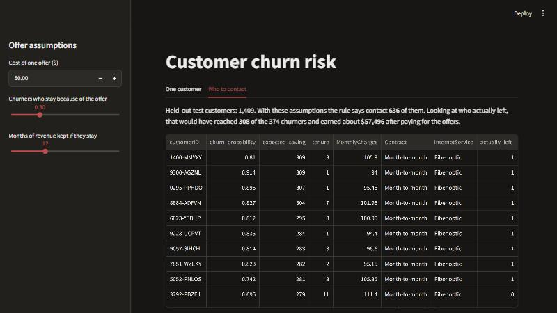
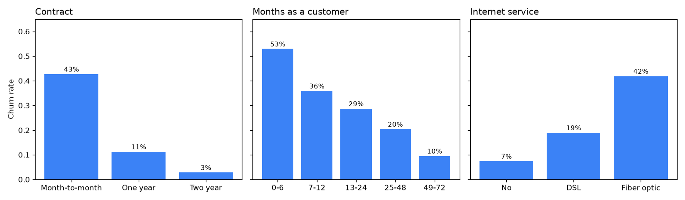
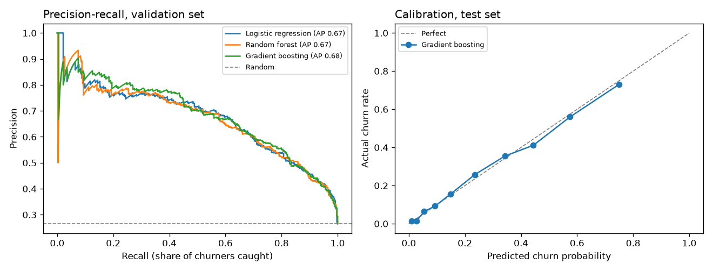
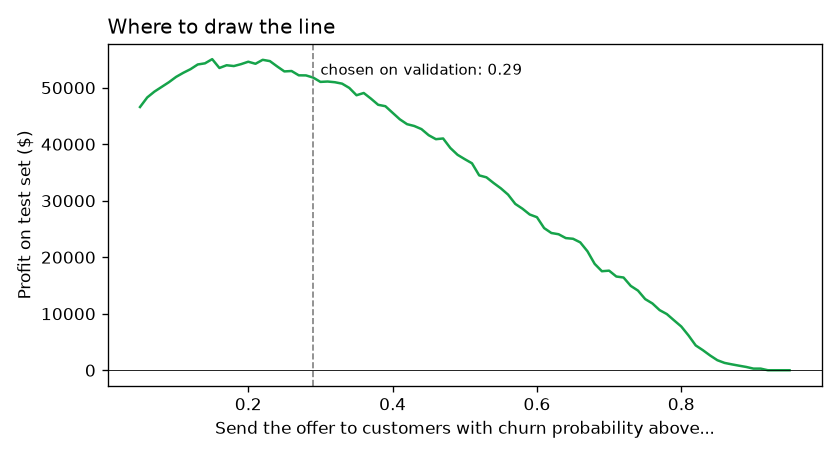
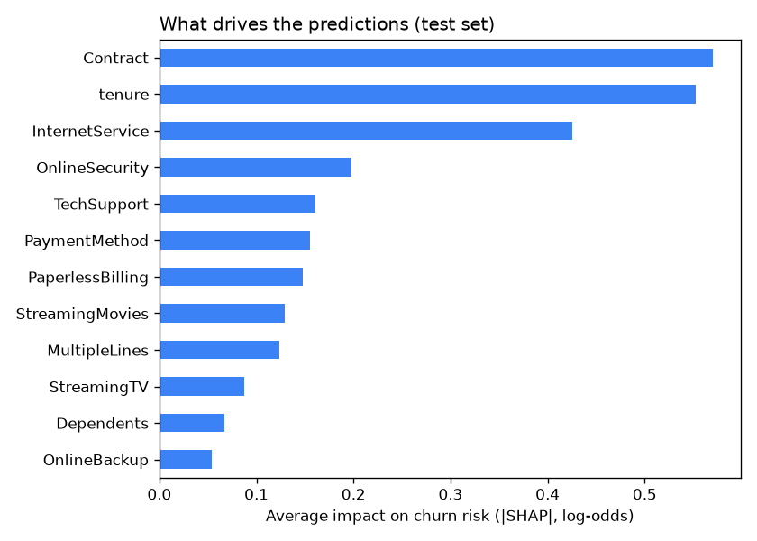

# Telco Customer Churn

[](https://github.com/eslammohibrahim/telco-churn/actions/workflows/tests.yml)

Predicting which telecom customers are about to leave, and then the part I actually cared about: deciding who should get a retention offer so the company makes money instead of handing out discounts to everyone.

On the held-out test customers, sending offers based on each customer's expected value would have earned about $57.5k after paying for the offers. Using the usual 0.5 probability cutoff earns $37.4k, and simply sending the offer to everyone earns $30.9k. Those money figures depend on assumptions I made up (below), so the comparison between strategies matters more than the exact amounts.



## Data

The IBM Telco Customer Churn sample dataset: 7,043 customers, 26.5% of whom left. Each row has the customer's contract, services, billing and how long they've been a customer.

Two things to fix before modeling. TotalCharges is blank for 11 customers, and all of them have tenure 0, so they just joined and haven't paid anything yet. I set those to 0 instead of dropping them. Then I dropped TotalCharges completely, because it's basically tenure times the monthly bill (correlation 0.9996).



The patterns are strong. Almost half the customers on a month-to-month contract leave (43%), against 3% on a two-year contract. More than half of the people in their first 6 months leave. Fiber optic customers churn at 42%, more than twice the rate of DSL, even though it's the more expensive service, which looks like a price or quality problem worth looking into.

## A trap with the monthly bill

My first logistic regression used MonthlyCharges, and its odds ratio came out at 0.28, meaning a higher bill would make people less likely to leave. That's backwards: the customers who left had a median bill of $79.65, against $64.43 for those who stayed.

The reason is that the bill is almost completely decided by which services the customer has. A linear regression on the services alone explains 99.9% of it (R² 0.9988). With the services already in the model, the bill's coefficient ends up meaning something else and flips sign. I tried the model without MonthlyCharges and validation ROC AUC barely moved (0.8579 vs 0.8584), so I left it out of the model inputs. It's still used later to work out how much each customer is worth.

## Models

Split 60/20/20 into train, validation and test (4,225 / 1,409 / 1,409), keeping the 26.5% churn rate in each part. Every model got a grid search with 5-fold cross-validation on the training set, and I picked one by validation ROC AUC.

| Model | Validation ROC AUC | Validation PR AUC | Brier score |
|---|---|---|---|
| Logistic regression | 0.858 | 0.672 | 0.131 |
| Random forest | 0.856 | 0.668 | 0.134 |
| Gradient boosting | 0.860 | 0.680 | 0.130 |

The three are basically tied. Gradient boosting was slightly ahead, so that's the one I used. On the test set it gets ROC AUC 0.836 and PR AUC 0.641 (random would be 0.265 for PR AUC).



The calibration plot matters for what comes next. When the model says 40%, roughly 40% of those customers really leave, so the probabilities can be used as probabilities and not just as a ranking.

## Who should get the offer

To turn this into a decision I needed numbers the dataset doesn't have, so I made assumptions: an offer costs $50, 30% of customers who were going to leave stay because of it, and a customer who stays is worth 12 months of their bill. They're all in [`src/business.py`](src/business.py) and can be changed in the dashboard sidebar.

| Strategy on the test set | Customers contacted | Churners reached (of 374) | Profit |
|---|---|---|---|
| Nobody | 0 | 0 | $0 |
| Everyone | 1,409 | 374 | $30,941 |
| Probability above 0.5 | 288 | 185 | $37,356 |
| Probability above 0.29 (best cutoff on validation) | 567 | 293 | $51,792 |
| Expected saving above the offer cost | 636 | 308 | $57,496 |

The 0.5 cutoff is the default people use, but it leaves money on the table here because an offer is cheap compared to losing a customer. Tuning the cutoff on the validation set helps a lot. The last rule doesn't use a cutoff at all: for each customer it compares probability × 30% × 12 months of their bill against the $50 offer. It wins because it also takes into account that some customers pay much more than others.



On the test set the best cutoff would actually have been lower than 0.29, around 0.15 to 0.2, but I kept the one chosen on validation so the test numbers stay honest.

## Why a customer is flagged

I used SHAP to see what pushes each prediction up or down, and added the one-hot columns back together so every reason is about a real column.



Contract type, tenure and internet service matter most, followed by not having online security or tech support. One customer from the test set: 3 months in, $100.95 a month, month-to-month contract, fiber, paying by electronic check, no tech support. The model gives him 81%, and he did leave. The top reasons it lists are the short tenure, the fiber connection and the monthly contract. For someone like that, offering a discounted yearly contract or free tech support makes more sense than a generic discount.

## Dashboard

`streamlit run app/app.py` opens two pages. "One customer" lets you fill in a profile and shows the churn probability, the expected saving from an offer, whether to send it, and the main reasons. "Who to contact" ranks the test customers by expected saving and updates when you change the assumptions in the sidebar.

## Run it

```bash
python -m venv .venv
.venv\Scripts\activate        # on macOS/Linux: source .venv/bin/activate
pip install -r requirements.txt

python src/train.py           # downloads the data, trains the models, picks the cutoff
python src/explain.py         # SHAP explanations
streamlit run app/app.py      # dashboard
pytest
```

## Project structure

```
src/
  data.py        loading, cleaning, split
  train.py       model comparison, calibration, offer strategies, figures
  business.py    offer cost assumptions and the profit calculation
  explain.py     SHAP values grouped by original column
app/
  app.py         Streamlit dashboard
tests/
  test_churn.py  cleaning, split, profit math, sanity check on the model
reports/
  results.json   all metrics and strategy results
```

## Limitations and what I'd do next

The money numbers come from my assumptions, not from real offer data, and this is IBM's sample dataset, not a real company's. The bigger issue is that the model finds people likely to leave, not people an offer would actually change. Someone who has already decided to leave might ignore any offer. The proper next step is uplift modeling, which needs data from a past campaign where some customers got offers and some didn't.
